# 🌐 Awesome API Gateway & Management Integration 🚀

  <strong>A curated collection of industry-leading API Gateways, API Management (APIM) platforms, and microservices integration tools.</strong> 
  Explore in-depth enterprise SaaS pricing benchmarks, free tier limits, company valuations, and star-ranked open-source solutions.

---

[📖 Sector Overview](#-sector-overview--market-dynamics) • [💼 SaaS Gateways & APIM](#-saas-api-gateways--management-platforms) • [🔓 Open-Source Gateways](#-open-source-gateways--proxies) • [⭐ Star History](#-star-history) • [☕ Support](#-support)

---

## 📌 Introduction & SEO Highlights 🔍

Welcome to the definitive directory for **API Gateways**, **API Management (APIM)**, and **Cloud Integrations**. Whether you are architecting a high-throughput microservices mesh, setting up serverless ingress, implementing zero-trust API security, or calculating Total Cost of Ownership (TCO) across cloud providers, this repository benchmarks the best commercial SaaS vendors alongside battle-tested open-source alternatives.

Key focus areas covered in this guide:
- 🛡️ **API Security & Governance**: OAuth2/OIDC, JWT verification, rate limiting, mutual TLS (mTLS), and WAF integration.
- ⚡ **High-Throughput Proxies & Reverse Proxies**: Cloud-native ingress controllers, Envoy-based proxies, and service mesh sidecars.
- 💰 **Transparent Pricing & Free Tiers**: Detailed baseline monthly costs, free tier allowances, and trial limits.
- 📈 **Enterprise Market Intelligence**: Valuation metrics, ARR indicators, and industry consolidation trends.

---

## 📊 Sector Overview & Market Dynamics 📈

The global API management and gateway market is valued at approximately **$8.2 billion to $10.9 billion** and is projected to expand to **$22 billion to over $50 billion** by the early 2030s, growing at a robust CAGR between **15% and 22%**. Market concentration is **moderately concentrated to consolidated at the top**, where hyperscalers and enterprise software giants (Microsoft Azure, Google Cloud Apigee, AWS, and Salesforce MuleSoft) command the largest share of enterprise spend, while an active, innovative tier of specialized vendors (Kong, Tyk, Gravitee, Traefik Labs) competes aggressively on developer experience, multi-cloud flexibility, and open-source infrastructure.

---

## 💼 SaaS API Gateways & Management Platforms ☁️

The table below covers key SaaS and managed API gateway platforms, sorted in descending order by company scale (market cap / valuation / enterprise value).

| Product / Platform | Company Scale (Valuation / Revenue) | Starting Tier Pricing | Free Tier / Free Trial Limits | Description |
| :--- | :--- | :--- | :--- | :--- |
| **[Microsoft Azure API Management](https://azure.microsoft.com/en-us/products/api-management/)** ☁️ | **~$3.1 Trillion** market cap (Microsoft) | **$0.07/hour (~$48.03/month)** for Basic tier (1 unit); or **$0.042 per 10k calls** on Consumption tier | **Free tier (Consumption Tier)**: 1,000,000 API calls per month free per Azure subscription (max 3,000 operations per instance, no VNet) | Hybrid, multi-cloud management platform for APIs across all enterprise environments. |
| **[Google Cloud Apigee](https://cloud.google.com/apigee)** 🌐 | **~$2.1 Trillion** market cap (Alphabet) | **$20 per 1 million calls** (first 50M calls) + **$0.50/hour** base environment fee (Pay-As-You-Go) | **60-day free trial**: Full access to Apigee evaluation organization and sandbox for 60 days | Enterprise full-lifecycle API platform featuring AI-assisted governance, mediation, and monetisation. |
| **[AWS API Gateway](https://aws.amazon.com/api-gateway/)** ⚡ | **~$1.9 Trillion** market cap (Amazon) | **$1.00 per 1 million calls** (HTTP APIs) / **$3.50 per 1 million calls** (REST APIs) | **AWS Free Tier (12 Months)**: 1,000,000 REST API calls, 1,000,000 HTTP API calls, and 1,000,000 WebSocket messages/month | Serverless, fully managed service for creating, publishing, maintaining, and securing APIs at scale. |
| **[Salesforce MuleSoft Anypoint](https://www.mulesoft.com/)** 🔗 | **~$6.5 Billion** acquisition value / **~$300M+** ARR (Salesforce subsidiary) | **$68,695/year** median contract benchmark (approx. **$5,725/month** entry level) | **30-day free trial**: Full platform evaluation sandbox (deployment to live production environments blocked) | Integration and API management suite linking enterprise applications, data streams, and microservices. |
| **[Postman API Platform](https://www.postman.com/)** 📬 | **$5.6 Billion** valuation / **~$300M+** ARR | **$19/user/month** (Team tier, billed annually) or **$14/user/month** (Basic) | **Free forever plan**: 1 user seat, up to 10,000 Postman API calls/month, 5 integrations total, 1,000 cloud collection runs | Collaborative API development and lifecycle platform with connectors and integrations for all major gateways. |
| **[Kong Konnect](https://konghq.com/products/kong-konnect)** 🦍 | **$2.0 Billion** valuation / **$100M+** ARR | **$500/month** (Konnect Plus, includes 1 dedicated cloud gateway control plane & 1M API requests) | **30-day free trial** of Konnect Plus (1M requests/mo); or **Kong Gateway OSS** (Apache 2.0, self-hosted, unlimited calls) | High-performance API gateway and cloud control plane built on Lua/Nginx and Rust plugins. |
| **[WSO2 API Platform](https://wso2.com/api-platform/)** 🏛️ | **$600 Million** acquisition value / **~$100M+** ARR | **$119/month** (Pay-as-you-go Cloud, up to 10 managed interfaces, 10M gateway events) | **30-day free trial**: Up to 5 managed interfaces and 10M gateway events; or **WSO2 API Manager OSS** (Apache 2.0, unlimited self-hosted) | Comprehensive open-source and SaaS digital integration and API management platform. |
| **[Gravitee.io](https://www.gravitee.io/)** 🪐 | **~$220 Million** valuation / **$22M** ARR | **$2,500/month** (Planet tier, 1 production + 1 non-prod gateway, unlimited users) | **Free tier (Gravitee Cloud Cockpit)**: Up to 2 logical environments per user; or **Community Edition OSS** (Apache 2.0, unlimited traffic, synchronous REST/SOAP) | Event-native API management platform supporting synchronous REST, GraphQL, and event brokers (Kafka, MQTT). |
| **[Tyk Technologies](https://tyk.io/)** 🚀 | **~$140 Million** valuation / **~$18M** ARR | **$600/month** (Starter / Core Cloud tier baseline) | **48-hour free trial (Tyk Cloud)**: Unrestricted access without credit card; or **14-day Enterprise Trial**; or **Tyk Gateway OSS** (MPL 2.0, unlimited self-hosted) | Lightweight, open-source-first API gateway and management platform written in Go. |
| **[Traefik Hub](https://traefik.io/traefik-hub/)** 🚦 | **~$50 Million** estimated valuation / **~$5M** ARR | **$3,333/month** ($40,000/year annual AWS Marketplace license entry with 24x7 support) | **30-day free trial** of Traefik Hub API Gateway; or **Traefik Proxy OSS** (MIT license, free forever, unlimited self-hosted) | Cloud-native edge router and API management layer designed for Kubernetes and microservices topologies. |

---

## 🔓 Open-Source Gateways & Proxies ⭐

Self-hosted, transparent, and community-driven API gateways and reverse proxies. The repositories below are sorted in **descending order of GitHub Star counts**, featuring clickable badges linking directly to their stargazers page.

| Repository | GitHub Stars Badge | License | Language | Description |
| :--- | :--- | :--- | :--- | :--- |
| **[traefik/traefik](https://github.com/traefik/traefik)** 🚦 |  | `MIT` | Go | Modern, dynamic HTTP reverse proxy and ingress controller built for microservices and container deployments. |
| **[Kong/kong](https://github.com/Kong/kong)** 🦍 |  | `Apache-2.0` | Lua / OpenResty | The world's most popular cloud-native API gateway, delivering sub-millisecond processing latency and extensive plugin architecture. |
| **[envoyproxy/envoy](https://github.com/envoyproxy/envoy)** 🛡️ |  | `Apache-2.0` | C++ | CNCF graduated high-performance L7 edge and service proxy designed for cloud-native applications and service mesh architectures. |
| **[cilium/cilium](https://github.com/cilium/cilium)** 🐝 |  | `Apache-2.0` | Go / C | eBPF-based networking, observability, and Kubernetes Ingress / API Gateway with ultra-high throughput L3/L4/L7 routing. |
| **[apache/apisix](https://github.com/apache/apisix)** ⚡ |  | `Apache-2.0` | Lua / Go | Apache Foundation top-level dynamic, real-time, high-performance API gateway handling routing, traffic control, and observability. |
| **[Netflix/zuul](https://github.com/Netflix/zuul)** 🎬 |  | `Apache-2.0` | Java | Netflix's edge service gateway providing dynamic routing, monitoring, resiliency, and security at massive streaming scale. |
| **[TykTechnologies/tyk](https://github.com/TykTechnologies/tyk)** 🚀 |  | `MPL-2.0` | Go | Fast, lightweight, open-source HTTP/REST and GraphQL API gateway with batteries-included quota management and authentication. |
| **[luraproject/lura](https://github.com/luraproject/lura)** 🌊 |  | `Apache-2.0` | Go | Ultra-performant, stateless framework for building API Gateways and Backends for Frontends (BFF), formerly KrakenD-CE core. |
| **[spring-cloud/spring-cloud-gateway](https://github.com/spring-cloud/spring-cloud-gateway)** 🍃 |  | `Apache-2.0` | Java | Modern non-blocking, reactive API gateway built on Spring Framework 5, Project Reactor, and Spring Boot. |
| **[emissary-ingress/emissary](https://github.com/emissary-ingress/emissary)** 🚪 |  | `Apache-2.0` | Go / Python | CNCF incubating, open-source Kubernetes-native API gateway and ingress controller built on the Envoy Proxy. |
| **[ory/oathkeeper](https://github.com/ory/oathkeeper)** 🔑 |  | `Apache-2.0` | Go | Cloud-native Identity & Access Proxy (IAP) and Zero-Trust reverse proxy authorizing incoming HTTP requests. |
| **[zalando/skipper](https://github.com/zalando/skipper)** ⚓ |  | `Apache-2.0` | Go | Extensible HTTP router and reverse proxy for service composition, Canary deployments, and custom filters. |
| **[ExpressGateway/express-gateway](https://github.com/ExpressGateway/express-gateway)** 📦 |  | `Apache-2.0` | JavaScript | Microservices API Gateway built entirely on Express.js, providing rich plugin pipelines and middleware composition. |
| **[krakend/krakend-ce](https://github.com/krakend/krakend-ce)** 🦑 |  | `Apache-2.0` | Go | High-performance open-source API Gateway engineered for microservices transformation and data aggregation without scripting. |
| **[wso2/product-apim](https://github.com/wso2/product-apim)** 🏛️ |  | `Apache-2.0` | Java | Complete, enterprise-grade open-source API management platform covering full API lifecycles, monetization, and developer portals. |
| **[gravitee-io/gravitee-api-management](https://github.com/gravitee-io/gravitee-api-management)** 🪐 |  | `Apache-2.0` | Java | Open-source API management engine facilitating synchronous REST and asynchronous event flows with policy controls. |

---

## 📈 Star History

---

## 💖 Support & Contributing 🤝

Thank you for exploring and bookmarking **Awesome-API-Gateway-Management-Integration**! 🎉

If you find this repository helpful, please consider supporting the project:
- ⭐ **Star this repository** to help other engineers, architects, and DevOps teams discover it.
- 🍴 **Fork and contribute**: We welcome PRs for new gateways, updated pricing tiers, benchmark results, or architectural blueprints.
- 📢 **Share** with your engineering team, tech community, or on social media.
- ☕ **Buy a Coffee / Sponsor**: Support ongoing maintenance and research on the [GitHub Sponsors Dashboard](https://github.com/sponsors/ishandutta2007).

---

  Built with ❤️ by <a href="https://github.com/ishandutta2007">Ishan Dutta</a> and the open-source community.

